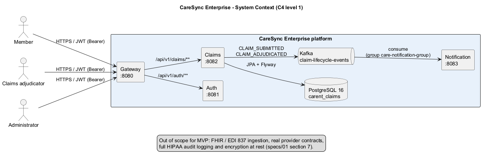

# CareSync Enterprise — Spec-Driven Development Kit

This folder is the **single source of truth** for building the CareSync healthcare claims platform with IBM Bob (or any AI coding assistant).

## Architecture at a glance



More views (topology, hexagonal layers, sequence, domain, state machine, Kafka events) are in [`specs/diagrams/`](specs/diagrams/README.md).

## Build and run

### Prerequisites
- JDK 17 or newer (the build targets Java 17)
- Docker with Compose v2 (for local PostgreSQL, Kafka and Kafka UI)
- No local Maven install needed: use the Maven Wrapper (`mvnw` / `mvnw.cmd`)

### Modules

| Module | Port | Role |
|--------|------|------|
| `care-gateway-service` | 8080 | Spring Cloud Gateway |
| `care-auth-service` | 8081 | JWT issuer |
| `care-claims-service` | 8082 | Claims domain, REST, persistence, Kafka producer |
| `care-notification-service` | 8083 | Kafka consumer (audit log) |

All services bind to `127.0.0.1` only.

### Build and test

```bash
./mvnw clean test      # unit tests + ArchUnit
./mvnw verify          # + integration tests (*IT)
./mvnw -pl care-claims-service test
```

On Windows PowerShell use `.\mvnw.cmd` instead of `./mvnw`.

### Local infrastructure

```bash
docker compose -f infra/docker-compose.yml up -d
```

- PostgreSQL 16: `localhost:5432`, database `carent_claims`
- Kafka (KRaft): `localhost:9092`
- Kafka UI: http://localhost:8090

Database and JWT credentials must come from environment variables; nothing secret is committed.

### Run a service

`care-claims-service` needs the database password in the environment (the value is in `infra/docker-compose.yml`; it has no default in `application.yml`):

```bash
export SPRING_DATASOURCE_PASSWORD=<value from infra/docker-compose.yml>   # PowerShell: $env:SPRING_DATASOURCE_PASSWORD = '...'
./mvnw -pl care-claims-service spring-boot:run
```

Optional overrides: `SPRING_DATASOURCE_URL`, `SPRING_DATASOURCE_USERNAME`. Flyway creates the `claim` table on startup.

Health check: `http://127.0.0.1:<port>/actuator/health`.

#### Auth service and gateway

Neither service has a default for its secrets, so each refuses to start without them. Generate your own values; do not reuse a real password.

| Variable | Used by | Meaning |
|----------|---------|---------|
| `JWT_SECRET` | auth, gateway | HS256 signing key, at least 32 characters. Must be identical in both. |
| `AUTH_MEMBER_PASSWORD` | auth | password of demo user `member1` (`ROLE_MEMBER`) |
| `AUTH_ADJUDICATOR_PASSWORD` | auth | password of `adjudicator1` (`ROLE_CLAIMS_ADJUDICATOR`, `ROLE_MEMBER`) |
| `AUTH_ADMIN_PASSWORD` | auth | password of `admin1` (`ROLE_ADMIN`) |
| `GATEWAY_SECURITY_ENABLED` | gateway | `true` (default) requires a valid JWT on `/api/v1/claims/**`; `false` is for local demos only |
| `CLAIMS_SERVICE_URI`, `AUTH_SERVICE_URI` | gateway | downstream base URLs (default `http://127.0.0.1:8082` / `8081`) |

```bash
./mvnw -pl care-auth-service spring-boot:run
./mvnw -pl care-gateway-service spring-boot:run
```

Get a token and call the claims API through the gateway:

```bash
curl -s -X POST http://127.0.0.1:8080/api/v1/auth/token -H 'Content-Type: application/json' \
  -d '{"username":"member1","password":"<AUTH_MEMBER_PASSWORD>"}'
# -> {"accessToken":"...","tokenType":"Bearer","expiresIn":3600}
curl -s -X POST http://127.0.0.1:8080/api/v1/claims -H "Authorization: Bearer <accessToken>" \
  -H 'Content-Type: application/json' \
  -d '{"memberId":"MEM-99201","providerId":"PRV-44102","serviceDate":"2026-10-25","billedAmount":"150.00","benefitCategory":"IN_NETWORK_PRIMARY_CARE"}'
```

### Demo walkthrough

Needs a container engine for the infra step (Docker or Podman). Open five terminals in the repo root: one for infra, one per service. Each service terminal has its own environment, so step 2 is repeated in every one.

1. **Infra** (PostgreSQL, Kafka, Kafka UI), in terminal 1:
   ```bash
   docker compose -f infra/docker-compose.yml up -d     # or: podman compose -f infra/docker-compose.yml up -d
   ```
2. **Load the environment** in each service terminal (2 to 5), before starting the service. The script reads the database password from `infra/docker-compose.yml` and, on first run, generates random `JWT_SECRET` and demo-user passwords into a git-ignored file (`.env.local.ps1` / `.env.local.sh`). Every terminal then gets the same values, which auth and the gateway need.

   PowerShell (note the leading dot and space):
   ```powershell
   . .\scripts\set-env.ps1
   ```
   Bash:
   ```bash
   source scripts/set-env.sh
   ```
   To choose your own values instead, set the variables listed in [`infra/samples/env.sample`](infra/samples/env.sample) by hand. Delete the `.env.local.*` file to regenerate.
3. **Start the services**, one per terminal (PowerShell: `.\mvnw.cmd` instead of `./mvnw`):
   ```bash
   ./mvnw -pl care-claims-service spring-boot:run          # terminal 2
   ./mvnw -pl care-notification-service spring-boot:run    # terminal 3
   ./mvnw -pl care-auth-service spring-boot:run            # terminal 4
   ./mvnw -pl care-gateway-service spring-boot:run         # terminal 5
   ```
   Check each one: `curl http://127.0.0.1:808{0,1,2,3}/actuator/health` returns `{"status":"UP"}`.
4. **Send claims** through the gateway (examples E1, E3, E5, E7 from `specs/03`):
   ```bash
   ./scripts/demo.sh          # PowerShell: .\scripts\demo.ps1
   ```
   Run it in a terminal where you loaded the environment (step 2), because it reads `AUTH_MEMBER_PASSWORD`.

   Expected: E1 `120.00` / `30.00` APPROVED, E3 `200.00` / `0.00` APPROVED, E5 HTTP 400 `Validation Failed`, E7 DENIED with `TIMELY_FILING_EXCEEDED`.
5. **Check the events**: open <http://localhost:8090> (Kafka UI), then Topics, `claim-lifecycle-events`, Messages. E1, E3 and E7 each show a `CLAIM_SUBMITTED` followed by a `CLAIM_ADJUDICATED` with the same key; E5 shows nothing.
6. **Check the notifications**: the `care-notification-service` console prints one line per adjudication, for example
   `[AUDIT NOTIFICATION] Member MEM-12345 notified: Claim CLM-20261031-891023 status updated to APPROVED. Payable: $120.00.`

To skip the login step, start the gateway with `GATEWAY_SECURITY_ENABLED=false` and run `NO_AUTH=1 ./scripts/demo.sh` (PowerShell: `.\scripts\demo.ps1 -NoAuth`). Local-demo only.

Optional: [`infra/samples/application-local.yml.sample`](infra/samples/application-local.yml.sample) shows the Postgres and Kafka settings for a git-ignored `application-local.yml`.

Stop with Ctrl+C in each terminal and `docker compose -f infra/docker-compose.yml down` (add `-v` to also delete the database volume).

#### Known limitations

- Events are published after the database commit with no outbox, so if Kafka is down the claim is stored and the event is lost.
- The 24-hour duplicate check and the save are not atomic; two identical concurrent submissions could both be approved.
- The gateway validates the token but does not enforce roles (optional in `specs/07`).
- Nothing in the API reverses a claim, so `CLAIM_REVERSED` is consumed but never produced.
- Spring Boot 3.5.16 is the newest 3.x release; Boot 4 / Spring Cloud 2025.1 is the next major step (not done here). Check the Spring support calendar for the 3.5 end-of-support date.
### Status

Slices 0-6 done: parent POM, four buildable modules, and in `care-claims-service` the pure domain (claim aggregate, `AdjudicationEngine`), the application service with its ports, a Flyway/JPA persistence adapter, the REST API (`POST /api/v1/claims`, `GET /api/v1/claims/{claimReference}`) with RFC 7807 errors, and a Kafka publisher for `CLAIM_SUBMITTED` / `CLAIM_ADJUDICATED` on `claim-lifecycle-events`. `care-notification-service` consumes that topic and writes the audit lines from `specs/04`. `care-auth-service` issues HS256 JWTs with roles at `POST /api/v1/auth/token`; `care-gateway-service` routes `/api/v1/claims/**` and `/api/v1/auth/**` and validates the JWT unless `GATEWAY_SECURITY_ENABLED=false`.

---

## How to use with IBM Bob

1. Open the empty (or scaffolded) multi-module repo in your IDE with Bob enabled.
2. Point Bob at this `specs/` directory first.
3. Use **Plan mode** for architecture and module layout, then **Code mode** for implementation.
4. Follow the mandatory workflow in `specs/00-development-process.md`:
   - Discover → Acceptance test (Red) → Implement (Green) → Refactor → ArchUnit green.

### Recommended first prompts for Bob

```
Read specs/00-development-process.md, specs/01-architecture-spec.md, 
and specs/05-module-structure.md. Create the Maven multi-module parent 
and the four service modules with empty hexagonal packages and ArchUnit rules.
Do not implement business logic yet.
```

```
Read specs/02-domain-model-spec.md and specs/03-claims-adjudication-spec.md.
Implement the pure domain model and Benefits/Adjudication calculator 
for care-claims-service with unit tests that encode every example in the spec.
```

```
Read specs/openapi.yaml and specs/01-architecture-spec.md.
Implement the REST adapter, DTOs, RFC 7807 error handling, and acceptance tests 
for POST /api/v1/claims and GET /api/v1/claims/{claimReference}.
```

## What is included

| File | Purpose |
|------|---------|
| `specs/00-development-process.md` | Mandatory AI + human workflow, Definition of Done |
| `specs/01-architecture-spec.md` | Microservices topology, hexagonal rules, tech constraints |
| `specs/02-domain-model-spec.md` | Entities, value objects, invariants |
| `specs/03-claims-adjudication-spec.md` | Example Mapping rules + concrete examples (test oracle) |
| `specs/04-events-messaging-spec.md` | Kafka topics, event schemas, consumer behaviour |
| `specs/05-module-structure.md` | Exact Maven modules, packages, parent POM guidance |
| `specs/06-testing-and-quality.md` | Test pyramid, ArchUnit, mutation, coverage expectations |
| `specs/07-security-and-errors.md` | JWT roles, RFC 7807 catalogue, validation |
| `specs/openapi.yaml` | Contract-first OpenAPI 3.0 |
| `specs/diagrams/` | Architecture diagrams (PlantUML sources + rendered PNG/SVG): see [`specs/diagrams/README.md`](specs/diagrams/README.md) |
| `infra/docker-compose.yml` | Local PostgreSQL + Kafka (KRaft) + Kafka UI |
| `PROJECT_RULES.md` | Short rules file Bob / Claude should always load |

## Target outcome (interview / demo ready)

- Multi-module Spring Boot 3.2+ / Java 17+ platform
- Hexagonal claims service with pure domain + ArchUnit enforcement
- Contract-first REST + RFC 7807
- Kafka claim lifecycle events
- Gateway + simple auth service
- Notification consumer
- Full test suite (`mvn verify` green)
- Local infra via Docker Compose
