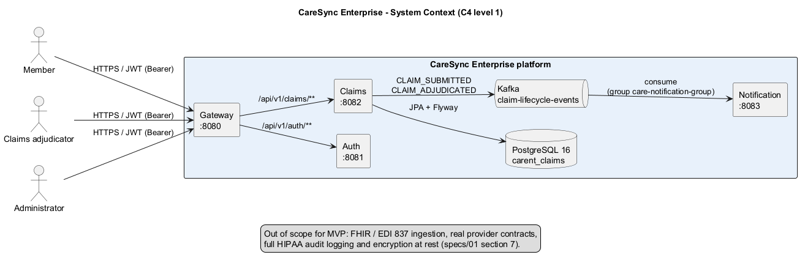
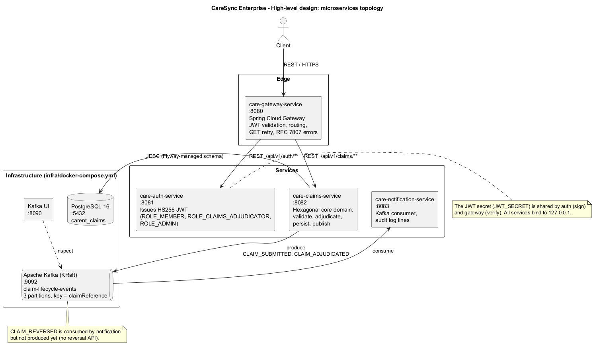
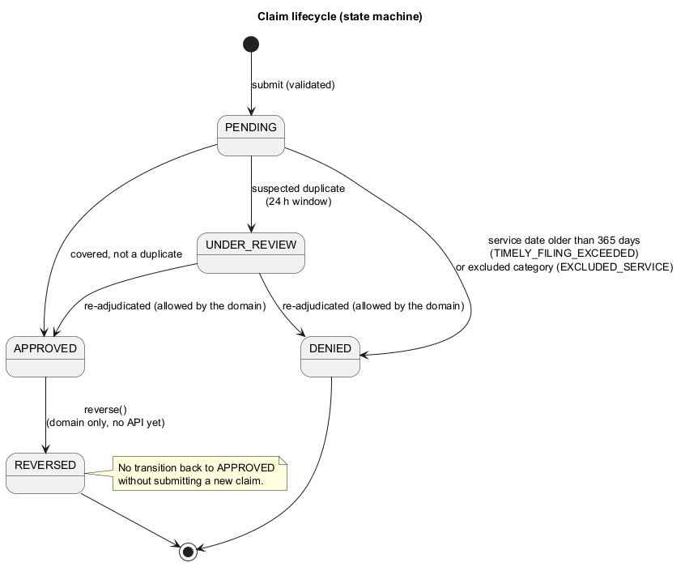

# CareSync architecture diagrams

Diagrams are kept as text (PlantUML) so they can be reviewed in pull requests. The rendered PNG and SVG
files are committed so they display on GitHub without any tooling. The sources describe the system **as
implemented** in this repository (ports, topics, statuses and rules match the code and `specs/`).

## Index

| # | Diagram | Source | Rendered | Answers |
|---|---------|--------|----------|---------|
| 1 | System context (C4 level 1) | [`01-birds-eye-system-context.puml`](01-birds-eye-system-context.puml) | [PNG](rendered/01-birds-eye-system-context.png) / [SVG](rendered/01-birds-eye-system-context.svg) | Who uses the platform and what is inside it |
| 2 | High-level design, microservices topology | [`02-hld-microservices-topology.puml`](02-hld-microservices-topology.puml) | [PNG](rendered/02-hld-microservices-topology.png) / [SVG](rendered/02-hld-microservices-topology.svg) | Services, ports, infrastructure, protocols |
| 3 | Hexagonal architecture of `care-claims-service` | [`03-hexagonal-architecture-claims.puml`](03-hexagonal-architecture-claims.puml) | [PNG](rendered/03-hexagonal-architecture-claims.png) / [SVG](rendered/03-hexagonal-architecture-claims.svg) | Packages, ports, adapters, dependency rule |
| 4 | Claim submission sequence | [`04-claim-submission-sequence.puml`](04-claim-submission-sequence.puml) | [PNG](rendered/04-claim-submission-sequence.png) / [SVG](rendered/04-claim-submission-sequence.svg) | Token, submit, adjudicate, publish, notify, read back |
| 5 | Domain model | [`05-domain-model-and-state.puml`](05-domain-model-and-state.puml) | [PNG](rendered/05-domain-model-and-state.png) / [SVG](rendered/05-domain-model-and-state.svg) | `Claim` aggregate, enums, adjudication engine |
| 5b | Claim state machine | same file as 5 (second diagram) | [PNG](rendered/05b-claim-state-machine.png) / [SVG](rendered/05b-claim-state-machine.svg) | Allowed status transitions |
| 6 | Kafka event flow | [`06-kafka-event-flow.puml`](06-kafka-event-flow.puml) | [PNG](rendered/06-kafka-event-flow.png) / [SVG](rendered/06-kafka-event-flow.svg) | Producer, topic, consumer, event types |
| 7 | Galaxy conceptual view | [`07-galaxy-conceptual-view.jpg`](07-galaxy-conceptual-view.jpg) | (image only) | Illustrative, presentation-style overview |







## About the galaxy view

[`07-galaxy-conceptual-view.jpg`](07-galaxy-conceptual-view.jpg) is an AI-generated, presentation-style picture. It is
conceptual and not a contract: it mentions capabilities (OAuth2 / OIDC, rate limiting, SMS and email delivery,
members and policies tables) that this MVP does not implement. Use diagrams 1 to 6 as the source of truth.

## Original drafts

[`assets/original-drafts/`](assets/original-drafts/) keeps the first hand-drawn versions for history. They differ
from the implementation: they show a "Patient Management" service that does not exist, a `ClaimCreatedEvent`
(the real events are `CLAIM_SUBMITTED` and `CLAIM_ADJUDICATED`), SMS / email alerts (the notification service
writes audit log lines), and a status flow that omits the 365-day timely-filing denial. Do not rely on them.

## Editing and re-rendering

Requires Java 17+. Download PlantUML from Maven Central (GPL/MIT/Apache/LGPL/EPL variants are published; check the
licence you prefer) and run from this folder:

```bash
java -jar plantuml.jar -tpng -o rendered *.puml
java -jar plantuml.jar -tsvg -o rendered *.puml
```

The `.puml` files use only PlantUML's built-in layout, so Graphviz is not required for the current set. If you use
IntelliJ, the "PlantUML Integration" plugin previews the files as you edit. Commit the updated `rendered/` files
together with the source change.

## Conventions

- File names: `NN-kebab-case-subject.puml`, numbered in reading order, from context (1) down to detail (6).
- One concern per diagram; link to `specs/` for the rules instead of repeating them.
- Draw what exists. Anything planned but not built (for example `CLAIM_REVERSED` production) is labelled as such.
